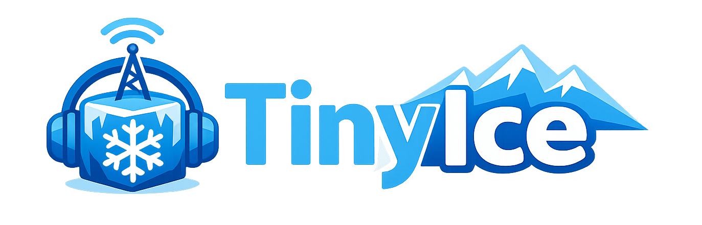
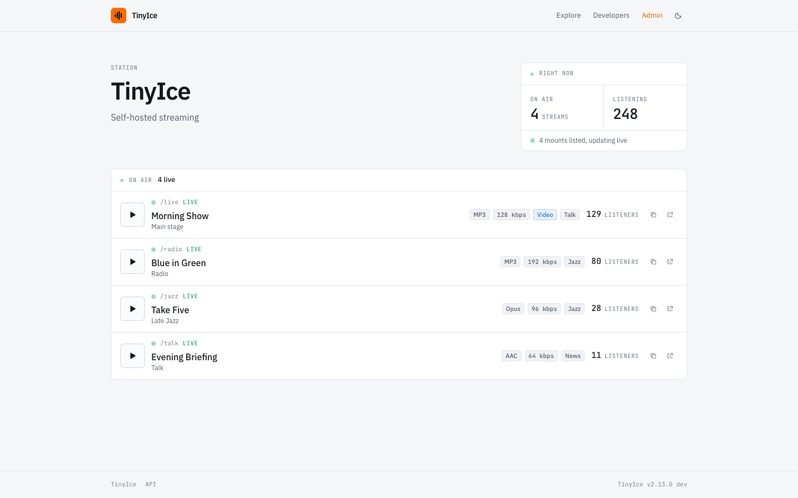
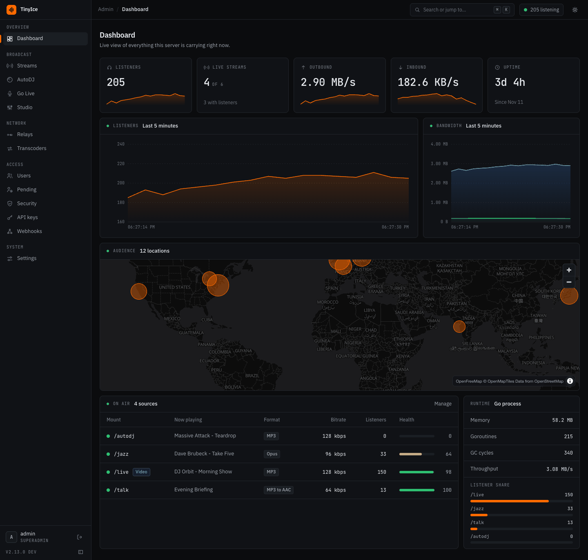
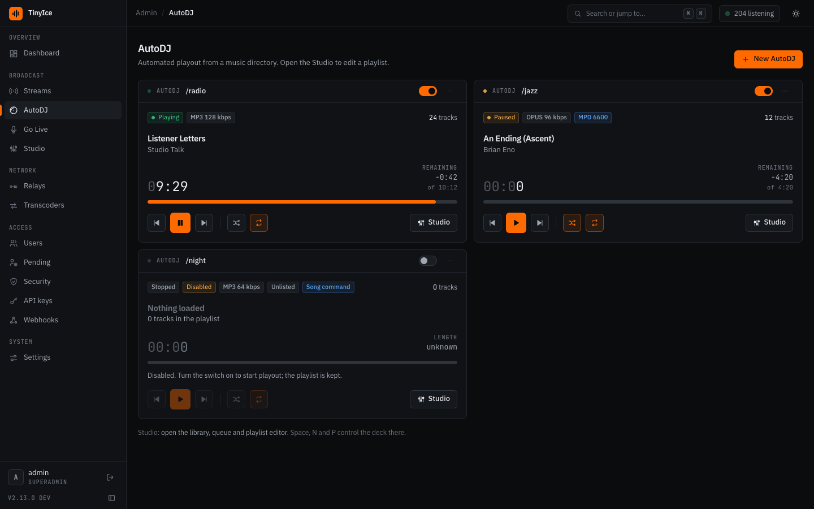
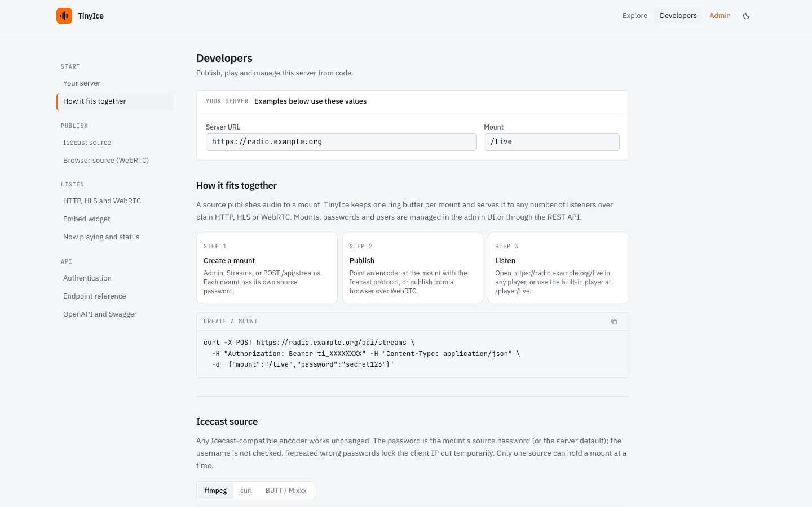

<div align="center">

# TinyIce



**One binary. Audio and video. Scales to six figures of listeners.**

Icecast-compatible streaming server with RTMP/SRT/WebRTC ingest, pure-Go
audio transcoding, HLS audio+video output, an AutoDJ with MPD remote
control, and a built-in admin SPA. Deploy anywhere in seconds.

[](https://goreportcard.com/report/github.com/DatanoiseTV/tinyice)
[](https://opensource.org/licenses/Apache-2.0)
[](https://go.dev)

[Quick start](#quick-start) · [Stream from OBS](#stream-video-from-obs) · [Documentation](#documentation) · [Deploy](#deploy)

</div>

---

## Screenshots

<table>
  <tr>
    <td width="50%" align="center">
      <a href="assets/screenshots/landing.png"></a>
      <sub>Landing</sub>
    </td>
    <td width="50%" align="center">
      <a href="assets/screenshots/admin-dashboard.png"></a>
      <sub>Admin dashboard</sub>
    </td>
  </tr>
  <tr>
    <td width="50%" align="center">
      <a href="assets/screenshots/admin-autodj.png"></a>
      <sub>AutoDJ</sub>
    </td>
    <td width="50%" align="center">
      <a href="assets/screenshots/developers.png"></a>
      <sub>Developer portal</sub>
    </td>
  </tr>
  <tr>
    <td colspan="2" align="center">
      
      <br /><sub>Video stream player</sub>
    </td>
  </tr>
</table>

---

## At a glance

| | |
|---|---|
| **Ingest** | Icecast2 SOURCE/PUT · RTMP (H.264 + AAC/MP3) · SRT MPEG-TS · WebRTC browser broadcasting · Icecast relay pull |
| **Output** | Icecast passthrough · HLS audio · HLS audio + video · WHEP / WebRTC playback · OBS simulcast (master playlist) · embeddable player |
| **Codecs** | MP3 · Ogg Opus · Ogg Vorbis · FLAC / FLAC-in-Ogg · WAV (8/16/24/32-bit & float) · H.264 · AAC-LC |
| **Transcoder** | Pure-Go multi-codec decode → MP3 or Opus with automatic resampling. No FFmpeg dependency. |
| **AutoDJ** | Multi-instance, keyframe-accurate pacing, shuffle/loop/queue, MPD protocol per instance, external track hooks |
| **Auth** | Username + bcrypt · Passkeys (WebAuthn) · OIDC/OAuth2 · Bearer API tokens · per-mount source passwords |
| **Player** | 16:9 video layout · live poster thumbnails · stats overlay (codec/res/fps/GOP/bitrate, dropped frames, buffer, latency) · 60 s DVR seek |
| **Ops** | Prometheus metrics · structured logging · ACME auto-HTTPS · zero-downtime hot-swap · multi-arch Docker on GHCR |
| **Deploy** | One static Go binary (~25 MB), all assets embedded · multi-arch Docker image · `.deb` / `.rpm` packages |

## Why TinyIce

- **One binary, no runtime dependencies.** Pure-Go SQLite, pure-Go audio
  decode/encode, embedded frontend — no FFmpeg, no GCC, no separate database.
  Cross-compiles to Linux, macOS, Windows, and FreeBSD.
- **Faces the internet directly.** Built-in ACME (Let's Encrypt) terminates TLS,
  and the shared circular-buffer broadcast path serves large listener counts
  from a single process. Run it straight on 80/443 — **no reverse proxy
  required**.
- **Icecast-compatible, not Icecast-bound.** Existing encoders and players keep
  working; HLS and WebRTC are layered on top for modern clients.
- **Secure defaults.** Credentials are generated on first run, mutating admin
  actions are CSRF-protected, outbound webhook/relay URLs are SSRF-guarded, and
  the packaged systemd unit ships masked so an unconfigured daemon can't
  auto-start.

---

## Quick start

### 1. Install

```bash
# Released binary
curl -LJO "https://github.com/DatanoiseTV/tinyice/releases/latest/download/tinyice-$(uname -s | tr '[:upper:]' '[:lower:]')-$(uname -m)"
chmod +x tinyice-* && mv tinyice-* tinyice && ./tinyice

# Or Docker — multi-arch images on GHCR (linux/amd64, linux/arm64)
# The image listens on 8080 and reads /data/config.json; reach it on :8000
docker run --rm -p 8000:8080 -v tinyice-data:/data ghcr.io/datanoisetv/tinyice:latest

# Or from source — Go 1.25+, Node 20+
git clone https://github.com/DatanoiseTV/tinyice.git && cd tinyice && make build
```

`.deb` / `.rpm` packages are attached to every release. Full matrix and options:
**[Installation](https://github.com/DatanoiseTV/tinyice/wiki/Installation)**.

### 2. First run

On first start TinyIce prints generated credentials **once** — save them:

```
FIRST RUN: SECURE CREDENTIALS GENERATED
  Admin Password:           Oy9…
  Default Source Password:  Rm3…
  Live Mount Password:      8fX…
```

Then open **http://localhost:8000** (and `/admin` to log in as `admin`).

### 3. Stream

| Source | How |
|---|---|
| **BUTT / Mixxx / LadioCast** | Icecast 2 · server `host:8000` · mount `/live` · password = *Live Mount Password* |
| **OBS** | See [below](#stream-video-from-obs) |
| **FFmpeg** | `ffmpeg -re -i input.mp3 -f mp3 -content_type audio/mpeg icecast://source:<pw>@host:8000/live` |
| **SRT** | `srt://host:9000?streamid=#!::r=live,m=publish,key=<pw>` from OBS, ffmpeg, or a DVB mux |
| **Browser** | Admin → **Go Live** for WebRTC mic/line broadcasting |
| **Files** | Configure an [AutoDJ](https://github.com/DatanoiseTV/tinyice/wiki/AutoDJ) pointed at a directory of audio files |

More ingest detail: **[Streaming Sources](https://github.com/DatanoiseTV/tinyice/wiki/Streaming-Sources)**.

---

## Stream video from OBS

TinyIce accepts H.264 + AAC (or H.264 + MP3) over RTMP and produces HLS
audio + video at `/<mount>/playlist.m3u8`.

1. **Enable RTMP** in `tinyice.json`:
   ```json
   "ingest": { "rtmp_enabled": true, "rtmp_port": "1935" }
   ```
2. **Create a mount** in Admin → Streams → Add Mount. The password is your OBS Stream Key.
3. **OBS → Settings → Stream** (Service: Custom): Server `rtmp://<host>/<mount>` (e.g. `rtmp://radio.example.com/live`), Stream Key = the mount's source password.
4. **OBS → Settings → Output**: video `x264` (or hardware H.264), audio `AAC` or `MP3`, **1 s keyframe interval** (matches the default segment size for lowest latency).
5. **Start Streaming.** The log shows `RTMP: Publishing started` and `Parsed AVC config`.
6. **Watch it:**
   - **Browser player** `https://<host>/player/<mount>` — 16:9 layout, STATS overlay (codec/res/fps/GOP/bitrate, dropped frames, buffer, latency), live viewer count.
   - **Direct HLS** `https://<host>/<mount>/playlist.m3u8` — VLC, mpv, ffplay, Safari, iOS.
   - **WebRTC** (sub-second, opt-in) — append `?webrtc=1` to the player URL; requires a B-frame-free encoder (`bf=0`).

Full pipeline notes, ABR/simulcast, and WHEP: **[Playback and Output](https://github.com/DatanoiseTV/tinyice/wiki/Playback-and-Output)**.

---

## Documentation

The complete operator and developer reference lives in the
**[Wiki](https://github.com/DatanoiseTV/tinyice/wiki)**.

| Getting started | Streaming | Operations |
|---|---|---|
| [Quick Start](https://github.com/DatanoiseTV/tinyice/wiki/Quick-Start) | [Streaming Sources](https://github.com/DatanoiseTV/tinyice/wiki/Streaming-Sources) | [Authentication & Users](https://github.com/DatanoiseTV/tinyice/wiki/Authentication-and-Users) |
| [Installation](https://github.com/DatanoiseTV/tinyice/wiki/Installation) | [Playback & Output](https://github.com/DatanoiseTV/tinyice/wiki/Playback-and-Output) | [Security](https://github.com/DatanoiseTV/tinyice/wiki/Security) |
| [Configuration](https://github.com/DatanoiseTV/tinyice/wiki/Configuration) | [AutoDJ](https://github.com/DatanoiseTV/tinyice/wiki/AutoDJ) | [Deployment](https://github.com/DatanoiseTV/tinyice/wiki/Deployment) |
| [Command Line & Signals](https://github.com/DatanoiseTV/tinyice/wiki/Command-Line-and-Signals) | [Transcoding](https://github.com/DatanoiseTV/tinyice/wiki/Transcoding) | [Observability](https://github.com/DatanoiseTV/tinyice/wiki/Observability) |
| [Troubleshooting & FAQ](https://github.com/DatanoiseTV/tinyice/wiki/Troubleshooting-and-FAQ) | [Webhooks](https://github.com/DatanoiseTV/tinyice/wiki/Webhooks) · [HTTP API](https://github.com/DatanoiseTV/tinyice/wiki/HTTP-API) | [Architecture](https://github.com/DatanoiseTV/tinyice/wiki/Architecture) · [Developing](https://github.com/DatanoiseTV/tinyice/wiki/Developing) |

Interactive API docs are served by every instance at `/api/docs` (Swagger UI),
with the OpenAPI spec at `/api/openapi.yaml`.

---

## Deploy

TinyIce is a single static binary with the admin UI, player, and assets embedded.

- **Direct / ACME:** enable `auto_https`, list your `domains`, and run on 80/443.
  TinyIce obtains and renews Let's Encrypt certificates itself. A reverse proxy
  is optional, not required.
- **Docker:** multi-arch images on GHCR — `:latest`, `:beta`, `:vX.Y.Z`, `:X.Y`, `:X`.
- **Packages:** `.deb` / `.rpm` install a hardened systemd unit, a dedicated
  `tinyice` user, and `/etc/tinyice` + `/var/lib/tinyice`. The unit ships masked
  by design — unmask, then `enable --now`.
- **Zero-downtime:** hot-swap the binary (`SO_REUSEPORT`) or reload config with
  `SIGHUP`. There is no in-process self-updater — update by replacing the binary,
  pulling a new image, or `apt`/`dnf upgrade`.

Sizing, reverse-proxy notes, and ACME details:
**[Deployment](https://github.com/DatanoiseTV/tinyice/wiki/Deployment)**.

---

## Develop

Requires **Go 1.25+** and **Node.js 20+**.

```bash
make build       # frontend + Go binary
make generate    # frontend only (go generate ./server/...)
make quick       # Go-only (reuse existing dist/)
make dev         # Vite frontend dev server (hot reload)
```

Frontend is **React 19 + Tailwind 4 + Radix primitives + Vite** in
`server/frontend/src/`, with its own icon set and widgets. `make dev` serves it
at http://localhost:5199 against built-in fixtures (no server or login needed;
`MOCK=0 make dev` proxies to a real server on :8000). The design rules are in
`server/frontend/DESIGN.md`. All dist assets are embedded into the Go binary via
`go:embed`, so the released binary is self-contained. See
**[Developing](https://github.com/DatanoiseTV/tinyice/wiki/Developing)** and
**[Architecture](https://github.com/DatanoiseTV/tinyice/wiki/Architecture)**.

---

## License

Apache License 2.0 — see [`LICENSE`](LICENSE). Security policy and disclosure:
[`SECURITY.md`](SECURITY.md).

---

<sub>Built by [DatanoiseTV](https://github.com/DatanoiseTV) · [Wiki](https://github.com/DatanoiseTV/tinyice/wiki) · [file a bug](https://github.com/DatanoiseTV/tinyice/issues)</sub>
